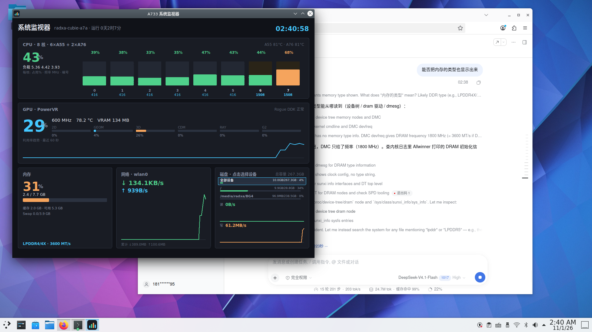

# A733 系统监视器

一个给 **Allwinner A733**（Radxa Cubie A7A / sun60iw2）用的轻量实时监控面板。
单文件、无重型依赖，能把 **PowerVR GPU 利用率**、**每核 CPU 占用与频率**、内存、网络、磁盘读写
放在同一个窗口里看。



## 功能

| 卡片 | 内容 |
|---|---|
| **GPU · PowerVR** | 总利用率、2D / GEOM / 3D / CDM / RAY / GEOM2 分模块占用、频率、温度、显存、60 秒趋势 |
| **CPU** | 总占用、每核占用率与**实时频率**、大小核分簇（6×A55 + 2×A76）、簇温度、负载均值 |
| **内存** | 占用率、已用/总量、缓存、Swap，以及**内存类型与速率**（如 `LPDDR4/4X · 3600 MT/s`） |
| **网络** | 上下行实时速率、60 秒曲线、累计流量 |
| **磁盘** | 按设备点选（全部 / eMMC / NVMe），各设备独立的**读、写曲线**，以及 已用 / 总容量 · 占用率 |

## 为什么需要一个小服务

GPU 数据只在 `/sys/kernel/debug/pvr/`（PowerVR Rogue DDK 的 debugfs），而 debugfs 是 `700 root`。
本项目**不改 sudoers**，而是用一个 systemd 服务以 root 每秒读一次，写到 `/run/a733-monitor/gpu.json`
（权限 `644`）：

```
a733-monitor.service → /usr/lib/a733-monitor/gpu-sampler.py → /run/a733-monitor/gpu.json → GUI
```

所以图形界面全程不需要提权，也没有密码弹窗。

## 安装

### 方式一：deb 包

```bash
sudo dpkg -i a733-monitor_1.2.1_all.deb
a733-monitor            # 或从 KDE 菜单「系统 → A733 系统监视器」启动
```

### 方式二：从源码运行

```bash
sudo install -m755 src/gpu-sampler.py /usr/local/bin/gpu-sampler.py
sudo install -m644 packaging/a733-monitor.service /etc/systemd/system/
sudo systemctl enable --now a733-monitor
./src/a733-monitor
```

### 自行打包

```bash
./build-deb.sh 1.2.1     # 生成 a733-monitor_1.2.1_all.deb
```

## 卸载

```bash
sudo dpkg -r a733-monitor
```

## 依赖

- `python3` + `python3-tk`（Tk 8.6）
- Debian 11 (bullseye) / Armbian 上测试通过

> 刻意没用 PyQt5：在 bullseye 上装 `python3-pyqt5` 会顶掉 `libqt5gui5-gles`，
> 连带卸载 plasma-desktop / kwin 等整个 KDE 桌面。

## 数据来源

| 指标 | 来源 |
|---|---|
| GPU 利用率 / 分模块 | `/sys/kernel/debug/pvr/status` |
| GPU 显存 / 驱动统计 | `/sys/kernel/debug/pvr/driver_stats` |
| GPU 频率 | `/sys/kernel/debug/clk/clk_summary` |
| GPU 温度 | `/sys/class/thermal/thermal_zone4`（`gpu_thermal_zone`） |
| 每核占用 | `/proc/stat` |
| 每核频率 | `/sys/devices/system/cpu/cpuN/cpufreq/scaling_cur_freq` |
| 内存用量 | `/proc/meminfo` |
| 内存类型 | `/proc/device-tree/compatible` → 板型查表 |
| 内存速率 | `/sys/class/devfreq/*dmc*/cur_freq` × 2 |
| 网络 | `/proc/net/dev` |
| 磁盘读写 | `/proc/diskstats`（按整盘，不按分区） |
| 磁盘容量 | `statvfs()` |

## 支持机型

| 板型（devicetree） | 内存类型 |
|---|---|
| `radxa,cubie-a7z` | LPDDR4/4X |
| `radxa,cubie-a7a` | LPDDR5 |

内存类型在 sysfs 里没有直接暴露。这里的做法是：读 `/proc/device-tree/compatible` 判断板型，
再查上表；DRAM 数据率由 DMC 时钟 × 2 得出。换成未知板型时该行会自动隐藏，不会显示错误值。

## 已知限制

- **每核温度拿不到**：芯片只有 4 个温度 sensor（小核簇、大核簇各一 + 两个 idle zone），
  没有 per-core 传感器，所以温度只能精确到「簇」。
- **浏览器视频硬解不可用**：板子有 VPU（`/dev/cedar_dev` + `sunxi_ve`），但系统没有 VA-API 驱动、
  也没有 V4L2 解码节点，Firefox/Chromium 无法对接；厂商只提供 Cedar + GStreamer(OpenMAX) 通路。
- GPU 利用率依赖厂商 PowerVR 驱动，换内核或换 SoC 后 debugfs 路径可能不同。

## License

MIT
